

  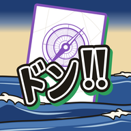

<h1 align="center">OP TCG Hub</h1>

  <b>A card scanner, collection tracker and price tracker for the One Piece Card Game, on Android.</b> 
  Free, works offline, no account.

  

  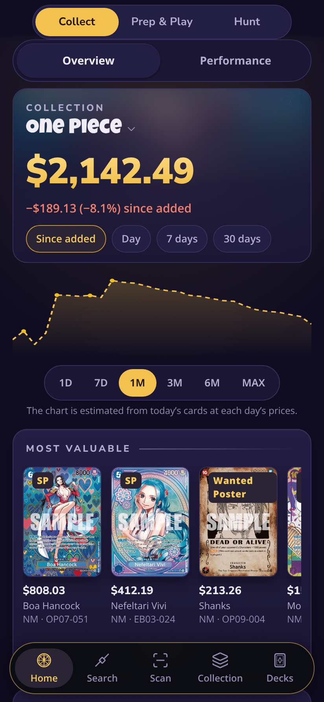
  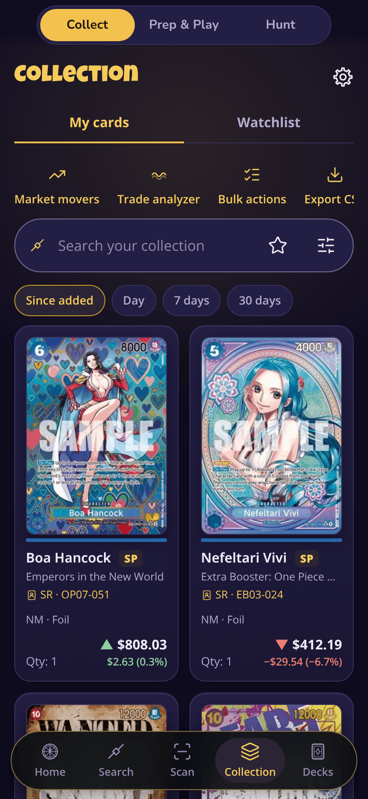
  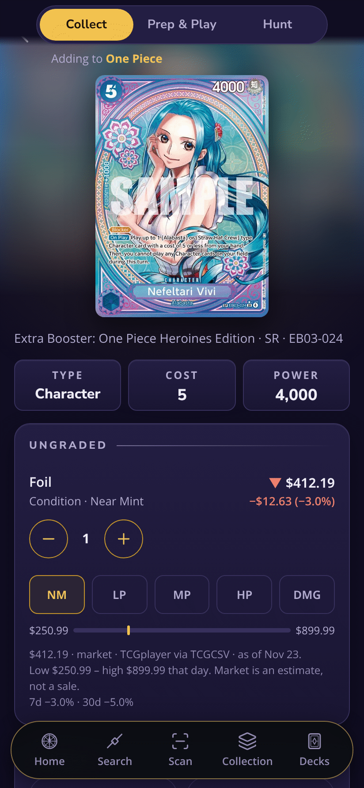
  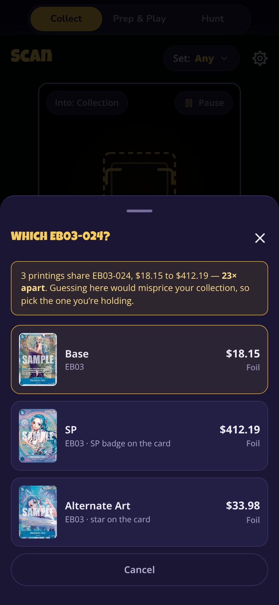

  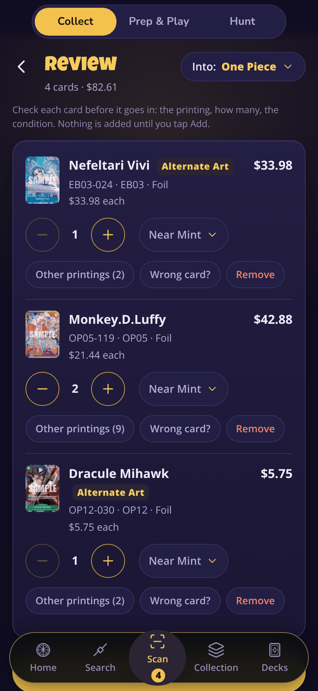
  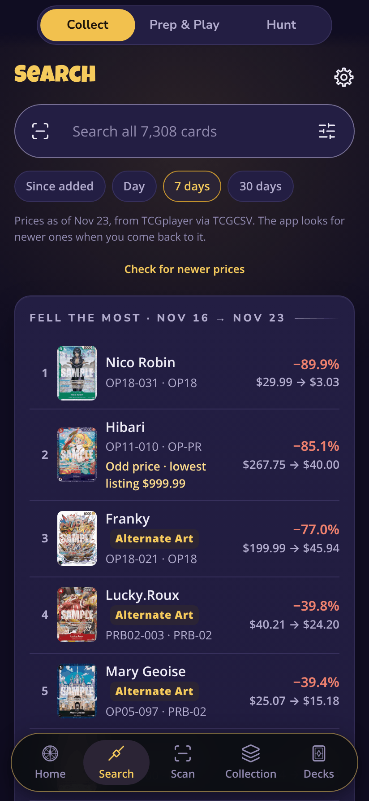
  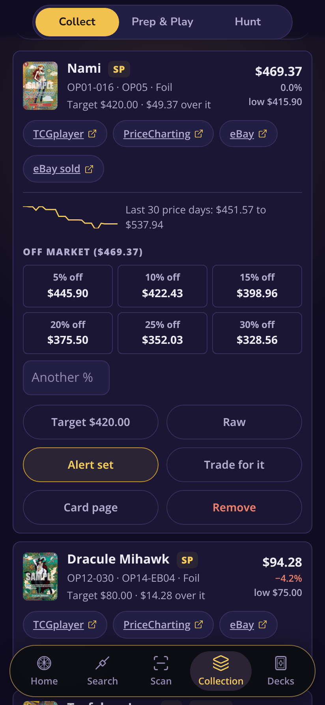
  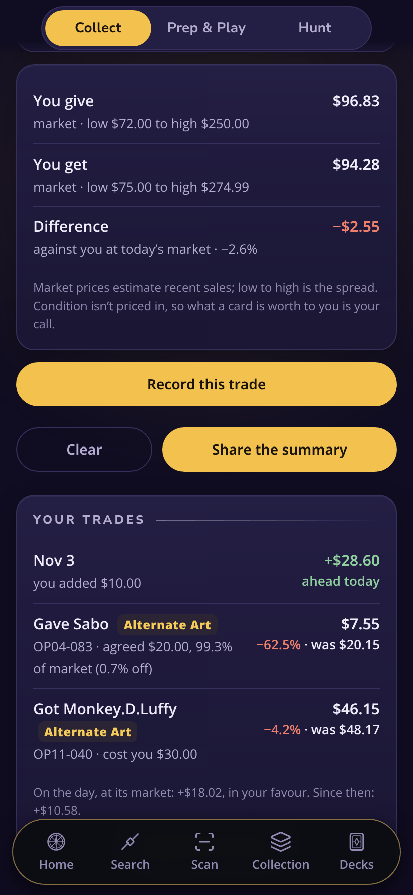

  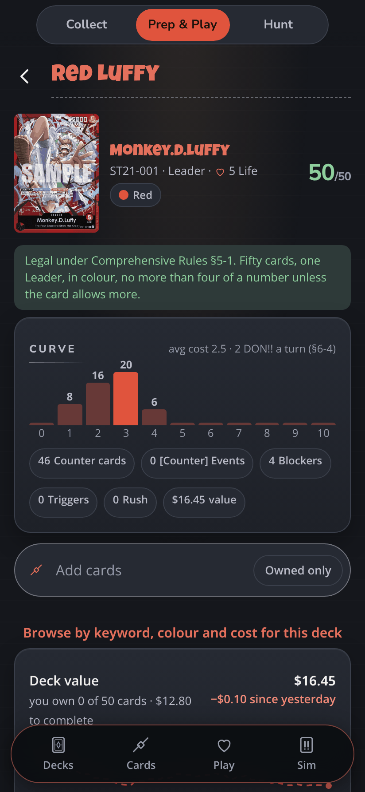
  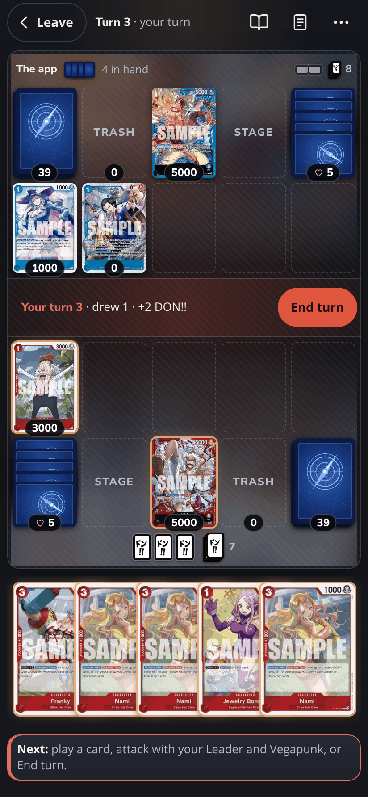
  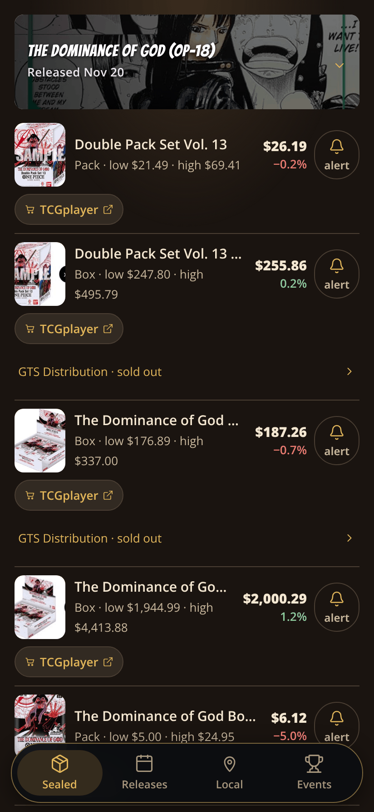
  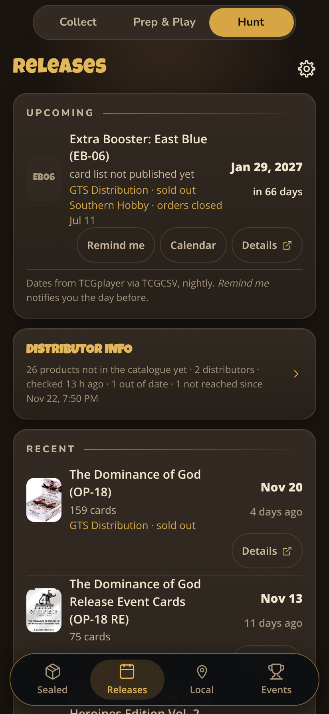

## Scan

- Tap **Scan** and point the camera at a card. Check the cards on **Review**, then tap **Add**.
  - Reads the card number printed on the card. Scanning is free and unlimited.
  - When printings of one number are far apart in price (base, alternate art, SP), it asks which one you hold instead of guessing.
  - On Review, change how many, the condition or the printing, or fix a wrong read. Nothing is added until you tap Add.
  - Zoom with a pinch or the zoom buttons, and Pause to frame a card first.
  - Scan from a photo or screenshot, or send scans straight to your Watchlist.

## Collection

- **Collection** lists your cards; tap one for its page. **Home** shows the total and your most valuable cards.
  - Every card is valued per printing at its TCGplayer market price.
  - See the change since you added a card, or over a day, 7 days or 30 days.
  - Separate collections (say, a binder and a trade pile), condition per copy, graded copies, and what you paid (the **Performance** tab compares).
  - Filter, sort, favourites and bulk edits; a nine-pocket binder view and set checklists.
  - A card's page shows the price's date and its low-to-high spread, every printing of its number, and links to TCGplayer, PriceCharting and eBay.

## Market movers

- **Collection → Market movers**, or on **Home** under the Watchlist: the top three each way, and **Show the rest** for the full lists.
  - What fell the most and what rose the most, 25 cards each, over a day, 7 days or 30 days.
  - Counts cards at $20 or more, or ones that doubled to or halved from $10 or more, so cheap swings don't crowd it.
  - A price four times or more below the cheapest listing, or above the dearest, is marked **Odd price** with that listing, so one strange sale doesn't pass for a real move.
  - Says which day its prices are from, then lists your own cards' moves.

## Watchlist

- **Collection → Watchlist**, or **Add to Watchlist** on a card's page, a search result or from the scanner.
  - The exact printing and grade you want, its market and low price, and how far it is from your target.
  - Tap a card for its last 30 days of prices, the market less 5–30% (or any percentage), a price alert and **Trade for it**.
  - **Check a slab** opens PSA's, CGC's, TAG's or Beckett's cert lookup.
  - Kept on your phone, so it works at a show with no signal.

## Trade analyzer

- **Collection → Trade analyzer**. Add what you give from your collection, and what you get from search or **Paste their list** (`4 OP01-016` per line).
  - Both sides valued the same way, with the spread and the difference.
  - **Record this trade** with the values you agreed and any cash either way; what you got comes in at what it cost you, and what you gave goes out (it asks first).
  - **Your trades** shows each trade then and now: ahead or behind.
  - **Share the summary** as text.

## Decks

- **Prep & Play → Decks**, then **+ New deck** or **Import a deck**.
  - Checks the official Comprehensive Rules as you build: Leader colours, 50 cards, at most four of a number.
  - Cost curve, counters, blockers, triggers and the deck's value.
  - Import a pasted list, a deck builder's link, or a photo or screenshot of a deck's QR code. Export as a list.
  - Ready-made decks from the starter decks, a card browser by keyword, colour and cost, and the rules, searchable.

## Play

- **Prep & Play → Play** or **Sim**.
  - **Play**: a Life and DON!! counter for games at the table.
  - **Sim**: play a deck against the app, or pass the phone between two players.
  - The Sim follows the rules; effects it can read from a card's text run on their own, and the rest you resolve by hand.

## Hunt

- Switch to **Hunt** and enter a zip code for local results (it stays on your phone).
  - **Sealed**: market, low and high prices for boxes, packs, decks and cases, with stock alerts.
  - Online stock and distributor status where the app has them, each with when it was last checked. Seller links open the seller's own page, with no referral links.
  - **Releases**: upcoming sets with a countdown, a reminder the day before, and add to calendar.
  - **Local** and **Events**: shops near you that run events, and their events with fee, seats and a register link.

## Your data

- No account and no sign-in.
- Your collection, decks and photos stay on your phone. Scanning, valuing and saving work with no signal.
- Backed up to `Documents/OPTCGHub` on every save (photos aren't included); restore the latest backup or an earlier day's.
- Export or import your collection as CSV at any time.
- Free, with short rewarded ads (Google AdMob) that earn save credits for scanned cards and new decks. Scanning is never limited, and if no ad is available, the save goes through anyway.
- The ads use your phone's advertising ID, the only identifier that leaves the phone. Nothing you scan or own is sent anywhere; prices and card pictures are plain downloads. See the [privacy policy](https://sergeantcs2.github.io/optcghub/privacy.html).
- This repository hosts the app's web data (prices and Hunt files) and its privacy policy. The app itself is on Google Play.

## Prices

- TCGplayer market prices via [TCGCSV](https://tcgcsv.com), refreshed daily. The app shows the day its prices are from.
- A market price is an estimate of recent sales, not an offer.
- There is no per-condition pricing: condition is recorded beside a card, never multiplied into its price. Graded copies show the ungraded price.
- Japanese printings are not covered. Sealed product is added by hand.

## Disclaimer

Not affiliated with Bandai, Shueisha, Toei Animation, Viz Media or TCGplayer. Google Play and the Google Play logo are trademarks of Google LLC.
